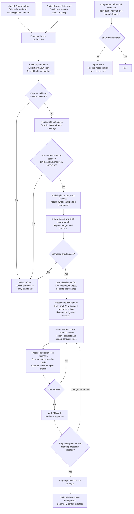

# Hosted workflow and approval guide

[Back to README](../README.md#workflow-overview)

## Current implementation

The repository has three hosted workflows:

| Workflow | How it starts | Where it stops |
|---|---|---|
| [Regenerate static documentation](../.github/workflows/regenerate-docs.yml) | Manual **Run workflow** dispatch. | Audited snapshot published as Actions artifacts and versioned Release assets, optionally including a supplied syntax capture. |
| [Extract documentation](../.github/workflows/extract-docs.yml) | Separate manual dispatch selecting a committed snapshot or explicit Release. | Review artifact containing raw records, parsed signatures, provenance, changes, and conflicts. |
| [Mirror drift](../.github/workflows/mirror-drift.yml) | Push to `main`, relevant pull request, or manual dispatch. | Pass/fail comparison of shared instructions and skills; no automatic repair. |

Regeneration does not automatically trigger extraction. There is currently
no automatic tool4d download/capture stage, scheduled content refresh,
review-PR creation, semantic approval, compiler verification, or downstream
CLI build/publication in these workflows.

## Proposed single-entry hosted flow

**This diagram is a design, not an implemented orchestrator.** The content
chain can run entirely on GitHub-hosted runners. Mirror drift remains
independent maintenance rather than a fourth sequential content stage.

The orchestrator would pass artifacts and provenance through explicit job
dependencies: **capture -> regeneration/publication -> extraction**.
Extraction must consume the exact published Release, not a moving `latest`
alias. A schedule needs an explicit policy for selecting the documentation
version and matching tool4d build; it must not silently pair unrelated
versions.

The proposed review handoff needs actual tracked changes to open a PR.
If extraction produces only an artifact, use an issue or notification to
request review, then open the corpus PR when reviewed edits exist. A draft
PR or a green extraction job is not semantic approval.

## Validation and approval gates

| Gate | How it is requested | How it is approved |
|---|---|---|
| Mechanical validation | Runs automatically within generation/extraction; proposed corpus PR checks would run on PR updates. | Scripts return success. No human or LLM approval is needed. |
| Semantic review | Proposed handoff links the artifact, identifies changes/conflicts, and requests designated reviewers. | Reviewed corpus changes pass checks, receive required GitHub PR approvals, and are merged. |
| Optional deployment approval | A separately configured publishing job targets a GitHub Environment with required reviewers. | An authorized reviewer approves the deployment in Actions, separately from semantic approval. |

Configure required PR reviews and status checks through repository rules or
branch protection. Configure deployment reviewers through GitHub
Environments if that additional gate is desired. This guide does not
configure those controls.

Publishing a snapshot preserves source evidence; it does **not** approve an
updated corpus. Extraction can succeed while reporting semantic conflicts
that need review. Follow [MAINTENANCE.md](MAINTENANCE.md) for updating
overlays, fixtures, registries, and approval state after source changes.

## tool4d capture prerequisites

Use the download rules owned by [the 4dcli skill](../skills/4dcli/SKILL.md#obtaining-tool4d),
mirrored from `miyako/skills`, rather than duplicating version/platform URL
rules here. Prefer a suitable existing installation for local use.

The installed macOS tool4d **21 R4 build 21R4.100208** was confirmed to
contain `Contents/Resources/en.lproj/syntaxEN.json`. Its bytes match
`references/syntaxEN-21-R4.json`, originally captured from the full 4D app.
This confirms that installation's layout, not every downloadable archive
or platform's layout.

Before automating capture, verify the selected public archive actually
contains the resource. A macOS archive can be inspected and its JSON
extracted on an Ubuntu runner without executing the macOS binary. Do not
assume the Linux archive exposes the same resource layout. Fail explicitly
if the matching public build or resource is unavailable; never substitute
an older capture or relabel it to match newer HTML.

Record the actual build, download URL, archive/resource hashes, and resource
path. Preserve the syntax resource unmodified and bundle its metadata with
the snapshot. Downloading and copying it requires neither tool4d execution
nor LLM inference.

## Determinism and AI boundary

Capture, generation, integrity checks, extraction, and drift detection are
mechanical operations requiring no LLM inference. Semantic review requires
human judgment or AI assistance; AI assistance does not replace required
reviewer approval. Compiler checks are mechanical but need a compatible
tool4d environment; tool4d requires no license activation.

No-LLM operation is not a guarantee of byte-for-byte reproducibility:
timestamps and run identifiers vary, default refs can move, and current
dependencies/actions are not all immutably pinned. Pin inputs and record
provenance for traceability.

Embedding generation and semantic search described in the root README are
separate model-inference paths, not stages in this hosted content chain.
